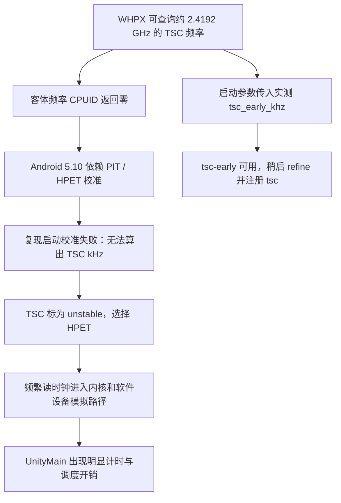

# WHPX 模拟器时钟退化调查（2026-10-08）

## 结论与证据边界

已确认当前 Windows/WHPX 环境存在“宿主机可提供 TSC 频率，但 Android 客体没有获得可用频率接口”的缺口。保留的复现启动日志显示，旧式 PIT/HPET 校准失败后，内核因无法计算频率而禁用 TSC、改用 HPET；此前慢实例的 UnityMain 采样也确实出现显著的 `read_hpet` 开销。这是已识别的底层性能问题，但现有证据不能把全部停滞都归因于它。

“Marking TSC unstable”在这次复现中的原因是 **could not calculate TSC khz**，不是已经测得硬件时钟漂移。该错误在启动日志约 0.048 秒处出现；没有记录证明原慢实例在长时间运行后才从 TSC 切到 HPET。启动时已处于慢路径、后续频繁读时钟时暴露症状，是与证据一致的解释。

本次只读取宿主和客体状态，并运行有界 CPUID/读时钟探针；没有重启 AVD、切换 clocksource、改系统设置、输入游戏、构建 Android 镜像或修改运行代码。游戏维护期间没有新增游戏任务验收。

## 本次环境与测量

| 项目 | 2026-10-08 实测值 |
| --- | --- |
| Android Emulator | 37.1.11.0，build 15917651，WHPX |
| 系统镜像 | API 32 / default / x86_64，revision 2 |
| 客体内核 | `5.10.101-android12-9-00027-g1292f517889e-ab8602202` |
| AVD | `E:\Runtime\AndroidAVD\alas_game_api32_x64.avd`，4 vCPU、4096 MB |
| 当次设备 | 实际发现的 `emulator-5564`，ADB server 端口 5037；不是未来启动的固定身份 |
| 宿主 CPU | Intel Core i9-13900HX，24 核 / 32 线程 |
| `WHvGetCapability(0x1004)` | 成功，8 字节，`2419202031 Hz` |
| 客体 CPUID `0x15`、`0x16` | 所有寄存器为零 |
| 客体 CPUID `0x40000000` | vendor 为 `WHPXWHPXWHPX`，EAX 为零 |
| 客体 CPUID `0x40000010` | 所有寄存器为零 |
| 客体 invariant TSC | CPUID `0x80000007` EDX bit 8 为 1 |
| 客体配置 | `CONFIG_KVM_GUEST=y`，`CONFIG_PARAVIRT_CLOCK=y`，`CONFIG_HYPERV` 未启用 |
| 探针前后 clocksource | 均为 `tsc`；available 为 `tsc hpet acpi_pm` |
| 当次已有启动参数 | `tsc_early_khz=2419202 clocksource=tsc` |

原始数据：[guest-clock-probe-r1.json](../artifacts/clocksource-research-20261008/guest-clock-probe-r1.json)、[guest-kernel-clock-config.txt](../artifacts/clocksource-research-20261008/guest-kernel-clock-config.txt)。探针：[clock_probe.c](../artifacts/clocksource-research-20261008/clock_probe.c)。客体可执行文件 SHA-256 和采样时间包含在 JSON 中。

这里读取的是 WHPX 的处理器时钟频率，不能用任务管理器或 `/proc/cpuinfo` 的动态 CPU MHz 替代。主机重启后的数值与前次略有不同，也不应将本次 `2419202` 固定为所有机器的常量。[Microsoft API 定义](https://learn.microsoft.com/en-us/virtualization/api/hypervisor-platform/funcs/whvgetcapability)

## 故障链



### 1. 频率信息没有传给能够使用它的客体接口

客体 CPUID 测量直接证实频率查询叶为空。Android QEMU 公开源码 `f0c183f1cc7456ecd6f3607f2f47893768ae4334` 的 WHPX 后端只拦截 `1`、`7`、`0x40000000`、`0x80000001`，设置 WHPX vendor 字符串，没有查询 `ProcessorClockFrequency` 并向客体提供 TSC 频率的实现。这与实测行为吻合。

**来源限制：尚未建立已安装 Emulator 37.1.11 二进制与该公开提交的精确构建对应关系。** 因而公开代码用于解释行为，不能作为已安装二进制的完整构建证明。[Android QEMU WHPX 源码](https://android.googlesource.com/platform/external/qemu/+/f0c183f1cc7456ecd6f3607f2f47893768ae4334/target/i386/whpx-all.c)

客体内核则按实际 `uname` 中的提交 `1292f517889e` 获取并核对：`native_calibrate_tsc()` 读取 CPUID `0x15`，分子或分母为零便返回失败；CPU 早期校准尝试 `0x16`、适用机型的 MSR、PIT。该内核没有 WHPX 专用识别项，当前也未启用 Hyper-V 驱动，不能假定已有 Hyper-V/KVM 半虚拟时钟可用。[精确内核 tsc.c](https://android.googlesource.com/kernel/common/+/1292f517889e/arch/x86/kernel/tsc.c)

### 2. 后备校准为何容易失败，哪些仍是推断

内核 `tsc_read_refs()` 在读取 HPET/PM timer 前后读取 TSC，超过时延阈值就丢弃本次样本，最多尝试 5 次。尚不知道 TSC 频率时，阈值为 `0x20000` cycles；按本机测得频率换算约 **54.18 微秒**。已知频率后的阈值约为 **31.25 微秒**。外围 PIT/参考计时器校准还有有限次数和偏差检查。

WHPX 的虚拟设备访问、宿主调度延迟或其他中断足以成为这种校准的干扰来源；但没有旧失败启动逐次读取的时延记录，所以 **不能宣称已经实测到某一次 HPET 读取超过 54.18 微秒，也不能认定具体哪个宿主线程或中断是触发源**。

可确认的结果来自 [r7 内核日志](../artifacts/continuity-20261004/emulator-r7.stdout.log)：

```text
[0.040000] tsc: Unable to calibrate against PIT
[0.044000] tsc: HPET/PMTIMER calibration failed
[0.048000] tsc: Marking TSC unstable due to could not calculate TSC khz
[1.736000] clocksource: Switched to clocksource hpet
```

r7 使用单核仍然失败，所以“仅由多核 TSC 不同步引起”不成立。内核在这条失败路径上不注册可用 TSC；运行中仅向 clocksource 的 sysfs 接口写入 `tsc` 不能补回缺失频率。

### 3. 为什么 HPET 会拖慢读时钟

公开 WHPX 后端通过 `WHvEmulatorTryMmioEmulation` 和 `cpu_physical_memory_rw` 处理 MMIO；QEMU 的 HPET counter 读取进入 `hpet_get_ticks()`，最终读取 `QEMU_CLOCK_VIRTUAL`。这一软件设备路径与直接读取 TSC 的成本不同。[WHPX 源码](https://android.googlesource.com/platform/external/qemu/+/f0c183f1cc7456ecd6f3607f2f47893768ae4334/target/i386/whpx-all.c)、[HPET 模拟源码](https://android.googlesource.com/platform/external/qemu/+/f0c183f1cc7456ecd6f3607f2f47893768ae4334/hw/timer/hpet.c)

旧慢实例的 [3 秒 UnityMain 采样](../artifacts/continuity-20261004/goal-r126-unitymain-profile-report-r1.log) 共 114 个样本，`read_hpet` 占 14.91%，`finish_task_switch` 占 22.81%；另一次调用栈包含 `clock_gettime`、HPET 和 futex。样本较少，这些是采样占比，不能直接换算成整个游戏墙钟耗时，也没有证明 observer 是唯一根因。

此前约 20 秒切到 `acpi_pm` 的 [对照记录](../artifacts/continuity-20261004/goal-r126-clocksource-ab-r1.json) 未见发布速度明显改善，随后恢复 HPET。它不能证明任何备用计时器都无效，但不支持把 `acpi_pm` 当作已经验证的解决方案。

## 已有绕过方案的有效性与局限

已有 r8/r9 启动向内核传入从当前宿主查询的 `tsc_early_khz`，并请求 `clocksource=tsc`。这补上早期频率，使内核可以先用 `tsc-early`，再进行延后校准。

- [r8 日志](../artifacts/continuity-20261004/emulator-r8.stdout.log)：约 8.49 秒 refine 到 `2419.200 MHz`，随后切为 TSC。
- [r9 日志](../artifacts/continuity-20261004/emulator-r9.stdout.log)：早期 `2419.202 MHz`，直到约 111.47 秒才 refine 到 `2419.190 MHz`，约相差 5 ppm，随后切为 TSC。延后校准可以等待可用采样；这段等待本身不能证明其全部时间都由同一种干扰造成。
- r8 的 [短时走时比对](../artifacts/continuity-20261004/goal-r127-tsc-time-rate-validation-r1.json)：客体经过 6.060 秒，落在宿主采样界定的 6.000–6.125 秒内。这排除了该短窗口内的明显走时倍率错误，不能证明长期精度。
- 既有记录显示恢复后原 ALAS Commission、Guild、ShopFrequent 各有一次整任务成功；本次没有重复游戏验收。旧、新启动还存在 vCPU 数等差异，不能拿 182662 ms 与 88630 ms 的启动时间当作严格隔离的两倍性能提升。

`Fast TSC calibration failed` 单独出现不代表绕过失败：早期 CPU 校准仍可能先输出该警告，然后采用传入的 TSC 频率。应结合最终 clocksource、后续日志和走时结果判断。

这里没有传入 `tsc=reliable` 或 `tsc=nowatchdog`。但不能进一步声称 watchdog 必定运行：该精确内核的 `check_system_tsc_reliable()` 会依据 constant/nonstop TSC、TSC_ADJUST 和节点数自动移除 TSC 的 watchdog 校验标志。正确表述是**未通过新增启动参数压制稳定性检查，保留内核原有决策**。

### 本次有界读时钟探针

探针每类调用做 5 批、每批 10000 次，共 200000 次。含 ADB 往返的宿主总耗时约 0.686 秒；探针前后均为 TSC。

| 调用 | 最小批次平均值 | 五批中位数 |
| --- | ---: | ---: |
| libc `CLOCK_MONOTONIC` | 29.214 ns | 253.071 ns |
| 直接 syscall `CLOCK_MONOTONIC` | 1388.599 ns | 2537.251 ns |
| libc `CLOCK_BOOTTIME` | 50.075 ns | 78.099 ns |
| 直接 syscall `CLOCK_BOOTTIME` | 1636.756 ns | 2725.967 ns |

批次波动明显，包含调度抢占等影响；不能当作纯指令延迟、稳定性能上限或 HPET/TSC 倍率对照。本次没有切回 HPET 以制造故障。

也没有打开 `/dev/hpet` 进行 mmap 测量：检查精确内核 `drivers/char/hpet.c` 后发现，即使只读打开，open/release 仍涉及 timer/IRQ 配置，不能将它当作完全无副作用的读操作。若后续需要精确复现 MMIO 校准失败，应放到可丢弃的独立实例。

## 建议实施顺序

1. **优先固化已有启动绕过。** 调查时 `scripts`/`python` 中未发现可复用的 WHPX 频率探测与启动参数生成实现（后续实现见下节）。让任务所属的 WHPX 启动器在每次启动时读取当前主机频率、转换为 kHz 并传入，随后记录实际 clocksource、校准日志和一次短时走时比对。查询失败应明确报告，不使用历史常量；不要因此新增全局 ALAS 功能禁用。这是修复遗漏启动参数风险所需的最小实现，无需 AOSP 构建。
2. **长期在虚拟化接口上补齐频率传递。** 上游 QEMU 早在 [2020 年提交](https://github.com/qemu/qemu/commit/5c8e1e832822f2e5bc630864a77eea40ee520a4f) 中就查询 WHPX TSC/APIC 频率并提供 VMware frequency leaf；本次检查的 Android fork 没有该实现。但不能直接断言移植这个补丁即可修好：当前客体 vendor 是 WHPX，旧内核 VMware 分支检查 `VMwareVMware` 并通过 vmport GETHZ 获取频率。必须同时确认客体消费者。对本机 Intel 客体，一个候选方向是提供与虚拟 TSC 一致、该内核能解析的 CPUID `0x15` 比例/晶振频率；其正确性、厂商适用范围和实际 Emulator 源码对应关系仍需实现阶段验证。
3. **仅在相应支持主张需要时扩展验证。** 启动器实现的必要检查是失败查询不产生伪造频率、参数单位正确、未误用于其他后端，以及实际启动后可用 TSC 和合理走时。游戏恢复后再做少量同配置任务验证。跨重启/休眠恢复与长期漂移尚未合格；只有准备承诺这些行为时才扩大验证，不先做清理重建或全矩阵。

调查阶段没有实施启动器修复或 Emulator 补丁。也没有修改 Windows BCD、Hyper-V、系统 HPET 设置、CPU 电源策略或内核校准阈值；现有证据不足以把这些改动列为必需措施。

## 后续实现：自动生成启动参数

2026-10-08 随后将频率探测接入既有 Windows 启动脚本，并新增主游戏 AVD 的薄入口 [start-alas-avd.ps1](../scripts/windows/start-alas-avd.ps1)。入口默认使用已有 `E:\Runtime\AndroidAVD\alas_game_api32_x64.avd`，不会创建、清空或停止 AVD；其底层仍是现有 [start-android-image-foundation-avd.ps1](../scripts/windows/start-android-image-foundation-avd.ps1)。不涉及 ALAS 状态机或游戏启动。

共享 [whpx-clock.ps1](../scripts/windows/whpx-clock.ps1) 先运行 Emulator 的 `-accel-check`，仅识别到 WHPX 时查询当前频率。频率按 Hz 四舍五入为 kHz，并校验 API 返回成功、实际返回 8 字节、数值非零且能表示为内核的 unsigned int。这里的检查仅防止错误频率被传入该次 WHPX 启动，不是全局任务准入条件。查询失败不使用历史值；修复宿主查询后可重入，也可显式 `-ClockMode Off` 不使用该绕过。其他加速后端保持原参数；加速检查失败会告警并不生成时钟覆盖参数。

`-qemu -append` 始终位于参数末尾，两个内核设置经 Windows 参数转义后作为同一个参数传递。主入口默认将内核 stdout/stderr 留在 `artifacts/avd-launch/`。DNS 不内置历史地址，需要覆盖时显式传入当前已验证的 `-DnsServer`。ADB server 端口可由 `-AdbServerPort` 指定，默认 5037。

先核对当前设备与 AVD 名称，并确定本次请求使用的偶数 console port，再设置 `$ConsolePort`。存在其他活跃使用者时不要为了应用时钟参数而重启。预览命令如下；它查询宿主能力和本地文件，不启动或停止模拟器、不创建日志目录：

```powershell
.\scripts\windows\start-alas-avd.ps1 -ConsolePort $ConsolePort -PlanOnly
```

之后在该 AVD 已正常停止、确需冷启动时移除 `-PlanOnly`，并显式带上当次需要保留的 `-AdbServerPort`、`-DnsServer` 等配置。若请求端口已有同名 AVD，脚本只报告 `already-running`、读取其 clocksource，并返回 `clock_configuration_applied=false`；它不会将旧进程冒充已应用新参数。仍应通过 `adb devices -l` 与 `emu avd name` 发现并核对实际设备，再在 `sys.boot_completed=1` 后读取：

```powershell
& $Adb -P $AdbServerPort -s $Serial shell cat /sys/devices/system/clocksource/clocksource0/current_clocksource
```

新启动回执的 `clocksource_verified=false` 是明确边界：成功生成参数、创建进程不等于客体已经使用 TSC。实际 clocksource、内核 refine 日志、短时走时和游戏恢复仍需要在冷启动后验证。游戏启动继续由原流程携带 Unity `-force-gfx-st`，本启动器不代替它。

验证结果：`PYTHONPATH=python python -m pytest -q tests/test_windows_whpx_clock.py` **16 passed**。覆盖当前频率与取整、失败/零值/溢出、不适用后端、显式关闭、真实 Windows 子进程参数往返，以及通过假 Emulator/ADB 可执行文件验证的启动、预览、失败不启动和已有实例不重启。假工具不具备启动 Android 的能力。本机实际 `-PlanOnly` 另读得 `2419202031 Hz`，生成 `tsc_early_khz=2419202 clocksource=tsc`；当时已有 Emulator PID 34408 保持运行。没有使用新入口执行真实冷启动，未新增游戏或长期时钟资格。

## 材料索引

新材料保留在 `artifacts/clocksource-research-20261008/`，包括探针源文件、可执行文件、原始 JSON、客体配置和源代码副本。[sources.json](../artifacts/clocksource-research-20261008/sources.json) 记录各源文件的获取 URL 与 SHA-256；Android QEMU 和精确客体内核引用固定提交。浮动 `android12-5.10` 的 VMware 文件只作比对，结论使用精确内核提交的对应文件。

研究探针留在当次客体 `/data/local/tmp/alas-clock-probe-20261008-01a11952`，不是服务，没有后台执行或定时任务。此次没有更改支持矩阵、补丁系列、发布等级或已有历史原始证据。


## 2026-10-09 同 userdata 实际启动器验证

经一次性 Windows 任务调用 `scripts/windows/start-alas-avd.ps1`，没有创建或清空AVD。r10 新查询 WHPX 2419200384Hz，追加2419200kHz；实际boot_completed=1，客体当前clocksource=tsc，内核完成2419.219MHz refined calibration并切至tsc。与系统时钟默认配置中的旧clocksource=pit同时出现时，最后的启动参数和实际sysfs/内核结果确认已生效，未仅凭命令行宣称成功。

证据 `artifacts/continuity-20261004/emulator-r10-launch.stdout.log`、`goal-avd-r10-cold-start-r1.json` 及 `avd-r10` 内核日志。20秒短窗口测得guest20.060s/host20.0625s，见 `goal-avd-r10-steady-clock-r1.json`；不覆盖休眠/唤醒或全天漂移。原生 ALAS 随后按-force-gfx-st启动game PID2050，fresh typed STATE/UI由76推进至后续5300+，原生Restart成功返回并开始后续任务。新签到页btnBack映射缺口另行修复，不能把原生unknown-page日志中的维护/网络猜测视为时钟或服务器故障结论。


### 2026-10-09 午后只读采样

r206原版队列等待期间，AVD进程PID42256及09:58:03.754675出生时间仍匹配。
只读采样两次实际clocksource均为tsc，guest boot_id一致；窗口guest20.0500秒，
host perf_counter20.0544859秒。原样数据在
`artifacts/continuity-20261004/goal-r206-current-tsc-steady-r1.json`。
系统clocksource sysfs文件对shell UID不可读，因此仅以su0执行cat读取该文件、
/proc/uptime和boot_id；没有启动/停止游戏、改变时钟参数或发送游戏输入。
此次显式保存Python perf_counter_ns与Windows GetTickCount64两种宿主采样值，
作为之后较长窗口的可比基准；不把旧短窗口未声明的宿主API直接当作精密
长时间漂移基线。新样本证明午后短窗口仍合理，不证明全天或休眠恢复。


13:59:52 的后续只读样本与 13:49:50 的同 boot_id 样本形成约 10 分钟窗口：
guest 601.900 秒、host perf_counter 601.8842686 秒、GetTickCount64 601.891 秒；
四次实际 clocksource 均为 tsc。差值约 0.0157 秒，小于端点 ADB 读取耗时
（0.0606/0.0923 秒），且 /proc/uptime 仅有百分之一秒精度；因此只说明
此窗口走时一致，不能宣称精密漂移率、全天稳定性或休眠/唤醒资格。
见 `artifacts/continuity-20261004/goal-r206-tsc-bounded-comparison-r1.json`，
原始后续样本为 `goal-r206-current-tsc-steady-r2.json`。未改变时钟参数或游戏状态。


14:40:18 后续样本将同一boot_id对比延长至3027.32852635秒宿主窗口：
guest3027.310秒、GetTickCount64 3027.336秒，差约-0.0185秒，仍在端点
ADB读取耗时（0.0606/0.0561秒）及guest百分之一秒精度内。此前与此次共
六个端点采样均为tsc，期间原版队列执行商店、奖励、科研并仅替换runner，
游戏/AVD没有重启。材料`artifacts/continuity-20261004/goal-r209-tsc-bounded-comparison-r1.json`
及`goal-r209-current-tsc-steady-r1.json`。该约50分钟实测覆盖本窗口走时，
不能据此提升为全天、连续clocksource监测或休眠/唤醒资格。


### 2026-10-09 15:26：同一客机启动实例约 97 分钟走时对比

在原版 Dorm、Shop、Commission、Research 执行以及仅 ALAS 进程重载期间，扩展此前明确声明主机 API 的对比端点：13:49:50 → 15:26:52，主机 `time.perf_counter_ns` 增量 5821.5423214 秒、`GetTickCount64` 增量 5821.547 秒；客机 `/proc/uptime` 增量 5821.520 秒。客机与主机 perf 增量差约 -0.0223214 秒，两个端点的 ADB 往返约 0.0606012/0.0932184 秒。因此窗口内走时相符，不能把差值当作精确 ppm 漂移测量。

8 个保留采样端点的 clocksource 均为 tsc，boot ID 仍是 `f8b4da6f-5d74-4ef1-a81e-aad33969f679`。这些是采样端点与有界区间证据，未宣称连续监测每一瞬间 clocksource，也不是全天、跨日或休眠/恢复资格验证。采样只读取 clocksource、uptime、boot ID，没有修改时钟参数，没有游戏输入或游戏/AVD 重启。新原始样本 `goal-r212-current-tsc-steady-r1.json`，派生对比 `goal-r212-tsc-bounded-comparison-r1.json`；旧原始样本未改写。

### 2026-10-09 16:17：约 147 分钟窗口与校频偏差待观察

同一 boot ID 的明确主机 API 对照延长至 13:49:50 → 16:17:18：主机 perf 增量 8847.80917635 秒、GetTickCount64 增量 8847.8125 秒；客机 uptime 增量 8847.740 秒，相差约 -0.06917635 秒。10 个保留端点的 clocksource 均为 tsc。新原始样本 `goal-r214-current-tsc-steady-r1.json`，派生对比 `goal-r214-tsc-bounded-comparison-r1.json`。

本次不能沿用“差值完全处于端点误差内”的表述：按 guest 读取发生在各自主机请求前后边界内、uptime 增量量化误差小于 0.01 秒计算，主机增量区间为 [8847.7515759, 8847.8667768]，客机量化区间为 [8847.730, 8847.750]，仍相隔约 0.0015759 秒。首末读取往返分别约 0.0606012/0.0545997 秒。保存严格边界计算于 `goal-r214-clock-endpoint-bound-r1.json`，不以小幅越界直接宣称精密漂移率。

核对保留的本次启动材料：WHPX 查询为 2419200384 Hz，客机日志 refined 频率为 2419.219 MHz（日志有取整）。假设这些频率代表窗口中的恒定计时比例，两者比例数值可对应约 -0.0680843 秒的窗口偏差，与观测幅度接近；这是相关性推断，尚不是因果证明。当前 boot ID 读取仍一致，未因这个小偏差改时钟参数、重启或增加任务限制。持续观察较长窗口与实际 ALAS 任务时序，全天、跨日及休眠/恢复仍未资格验证。
